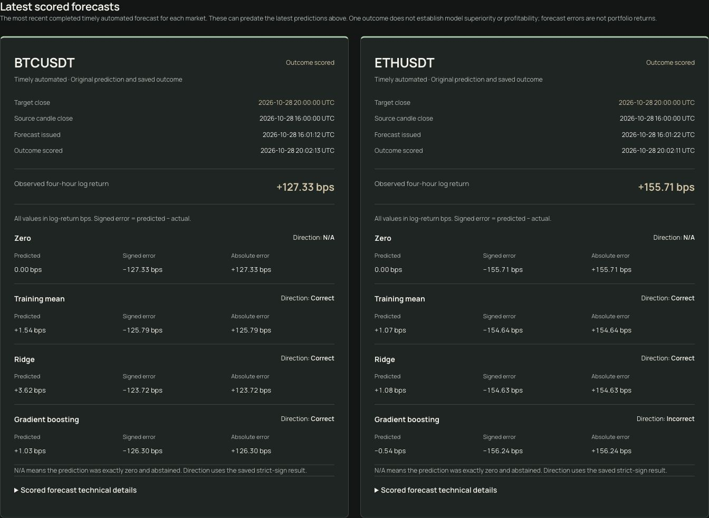

# Stage 5B.9 — Latest Scored Forecast and Homepage Refinement

**Completed locally:** 29 October 2026. **Status:** awaiting owner review.
No commit, push, deployment, R2 upload, Lightsail write, credential change,
scientific-protocol change or editorial approval change was performed.
The live website and continuously refreshing `forward-v1.json` pipeline remain
unchanged. This report records implementation and local evidence, not a release.

The [complete original request](../prompts/stage-05-web/011-latest-scored-forecast.md)
is archived verbatim. The continuation request also required a focused numerical
tolerance review, completion of regression/browser checks and reuse of the
previously authorised private evidence copy. The existing uncommitted implementation
was continued in place. Starting HEAD was
`45a96d4e133613ac9cc514babaf32647d8779a31`.

## User experience

The Burrow retains its latest-issued prediction cards and aggregate evaluations.
Between them, **Latest scored forecasts** shows an independent primary timely
automated observation for BTCUSDT and ETHUSDT. Each card includes source close,
original issuance, target close and scoring time; observed four-hour log return
once; four original model predictions; saved signed and absolute errors; and the
saved Correct / Incorrect / N/A directional result. Technical disclosures retain
recipe SHA-256, exact timestamp strings and original JSON numeric values, including
squared errors in squared log-return units.

Display values use the existing log-return-basis-point helper (`return × 10,000`).
Signed error is predicted minus actual. These are not simple percentage returns,
portfolio returns or evidence of profitability/model superiority. Zero retains
numerical errors but abstains from directional accuracy. Saved strict-sign results
are used rather than signs inferred from rounded displayed values.

A v2 market with no primary matched evidence says **No completed timely forecast
available yet.** A v1 snapshot explicitly says latest-scored observations are
unavailable in that snapshot version. Neither case substitutes a late/manual or
unattributed forecast. A newer pending prediction remains distinct from an older
completed observation. Polling, stale status and retained-last-good behavior remain.

The homepage Field Guide headline is exactly **Understand the methods behind the
numbers.** The eyebrow, Explore Field Guide link, three article destinations,
titles and reading-time metadata are unchanged. Balanced text wrapping replaces
the old manual line break. No article source bytes or approval hashes changed.

## Selection, provenance and contract

`public_forward_v2.py` reuses the frozen evaluator and existing v1 preparation:

1. Capture one evidence cutoff, validate retained records/outcomes and collection
   journals, and produce the frozen cohort report. Records issued after cutoff
   and scores captured after cutoff are not represented as available evidence.
2. Load the same retained observations and require exact matched-record-ID
   membership against every market/cohort aggregate through the v1 projection.
3. Reject ambiguous record IDs or duplicate market/source instants. For each
   market select the greatest source-candle instant among primary timely automated
   observations with a saved score available by cutoff. Scoring-arrival order does
   not determine the selection. Require the saved score's primary cohort.
4. Apply the shared public row allowlist; add only the saved actual direction and
   per-model saved directional correctness. No model fitting, database query,
   prediction reconstruction or replacement of saved scores occurs.
5. Compare the frozen report before/after preparation and the relevant JSON/partial
   file inventory before/after, including inode, modification/change times and
   SHA-256. Reject changed, replaced, added, removed, symlinked or nonregular evidence.
   Operational log subdirectories are not forecast evidence.
6. Stage privately under a non-overlap lock, with the existing 120-second CLI
   deadline, 64 KiB size limit, TypeScript validation and atomic mode-0600 output.
   Failed preparation/validation leaves the previous candidate intact. Require
   separate version paths, nonregressing cutoff/generation clocks and no removal,
   regression or alteration of an already retained latest-scored observation.

The shared `project_forecast` extraction preserves v1 field/value semantics and
default staging remains v1. `publish_forward_r2.py`, the v1 CLI validator and the
independent endpoint checker are unchanged. V2 staging explicitly rejects any
publication argument; it is private preparation only in this stage.

V2 retains the v1 top-level fields (`kind`, `data_source`, `protocol`, `protocol_sha256`,
`generated_at`, `as_of`, `latest`, `evaluations`), changes `schema_version` to 2 and
adds `latest_scored`. Its rows use the existing forecast fields plus
`actual_direction` (-1, 0 or 1); each of the four model objects additionally has
`directional_correct` (boolean, or null only for exact zero abstention).

Validation requires exact keys, approved symbols/models, finite values, recipe
hash format, UTC timestamps, four-hour boundaries, valid issuance/cohort timing,
settled scores no later than cutoff, and primary/scored identity. There are at most
two rows, without repeated markets. A row must exist iff its primary aggregate
has matched evidence. It cannot be newer than latest issuance; the same issuance
in both collections must have identical shared evidence, independent of JSON key
ordering. Microseconds are retained for chronology comparisons at these dates.
The browser bounds response bytes to 64 KiB and decodes UTF-8 strictly.

The strict v1 entry point still rejects v2/unexpected fields. The browser's
version dispatcher accepts either strict contract; an existing v2 loader rejects
schema downgrade, regressing clocks, lost/older scores and changed saved evidence.
A new configured v1 loader can be used for an explicit website rollback.

### Numerical comparison review

Exact JavaScript equality is inappropriate for independently represented decimal
values. V2 uses a bounded binary64 consistency allowance, without rewriting any
saved number:

- For signed error, `abs(saved - (prediction - actual))` must be no more than
  `8 × Number.EPSILON × max(abs(prediction), abs(actual), abs(prediction - actual))`.
- Absolute error must match `abs(saved signed error)` at its own scale with the
  same eight-epsilon factor; squared error must match the saved signed error
  squared at the squared-error scale.
- The expected value must be finite, and zero/nonzero classification and sign
  must agree exactly. There is no fixed absolute tolerance floor, no display-bps
  tolerance and no relaxation of direction or chronology.

This accommodates adjacent binary representations, decimal-derived examples and
subtraction cancellation while rejecting materially inconsistent errors even at
tiny scales. Regression cases cover positive/negative values, `3e-20 - 1e-20`,
near cancellation, and acceptance at four epsilon versus rejection at sixteen.
Wrong signs, zero substitutions and inconsistent absolute/squared errors fail.
The existing v1 numerical allowance remains unchanged.

The frozen evaluator uses exact Decimal close comparison for actual direction,
which can remain nonzero if the float log-return underflows to zero. V2 preserves
that saved direction rather than deriving it from the displayed numeric return.
Python's frozen retained-evidence validator remains the authority for provenance;
the public TypeScript consistency check cannot independently authenticate records
that are intentionally absent from the public allowlist.

## Genuine evidence used locally

The owner explicitly approved a private local evidence copy after the initial
copy request was rejected by automatic approval review as exceeding read-only
inspection permission. The completed acquisition compared file membership and
bytes during read-only collection. **4,459 retained files** were then verified
against its SHA-256 manifest. This stage's continuation reused that copy; it did
not transfer private evidence or credentials elsewhere. Raw records/journals and
the candidate remain outside the repository and static asset directories.

The genuine v2 candidate passed Python preparation and strict TypeScript validation:

| Property | Value |
| --- | --- |
| Evidence cutoff | `2026-10-28T22:43:07.922873Z` |
| Generated | `2026-10-28T22:43:09.049675Z` |
| Size | 14,218 bytes |
| SHA-256 | `3a86619c5c90e690cca2f4c178a67c7d33cfb10116c2508b7809f6fe6fc04c22` |
| Primary counts, each market | 86 issued, 85 matched |
| Late/manual counts, each market | 1 issued, 1 matched |
| Unattributed, each market | 0 issued, 0 matched |

| Saved scored observation | BTCUSDT | ETHUSDT |
| --- | --- | --- |
| Source close | 28 Oct 16:00 UTC | 28 Oct 16:00 UTC |
| Target close | 28 Oct 20:00 UTC | 28 Oct 20:00 UTC |
| Original issuance | `16:01:12.936151Z` | `16:01:22.953924Z` |
| Scoring time | `20:02:13.736644Z` | `20:02:11.007499Z` |
| Actual log return | `0.01273323510180051` | `0.015570668014292712` |
| Display | +127.33 bps | +155.71 bps |

The latest issued source close is 20:00 with target 29 October 00:00, pending at
the saved cutoff. Screenshots taken on 29 October correctly show stale retained
publication and mature-but-unpublished status for that later prediction. They are
dated historical evidence, not a claim about the current live feed. No clocks were
retimed to make this copy appear fresh. Synthetic regression fixtures are separate
and are never bundled into the static site.

Read-only production checks on 28 October found enabled, successful publication
and independent-check timers, healthy collector/scorer services and a valid v1
endpoint (cutoff `22:33:17.136746Z`, generated `22:33:32.627549Z`, 10,958 bytes,
SHA-256 `d732fc82b998c9aac24735d588cadc12d753ceca7e56c43ff8c5c8ea36fd8bb5`).
These are dated checks, not continuous monitoring. Production HTML showed
`index, follow`, the sitemap contained 13 URLs, robots advertised it, and www
HTTP redirected to HTTPS with path/query preserved. The owner confirmed Search
Console submission; actual Google indexing was not established. Historical audit
reports were preserved; current handoff/README statements were corrected.

## Validation and screenshots

Checks ran with Python 3.12, pinned Node 24.22.1 and pnpm 11.25.0:

| Check | Result |
| --- | --- |
| Exporter v1/v2 plus frozen forward/forward-evaluation pytest suites | 234 passed |
| Frontend Node test suite, including export checks | 128 passed |
| Separate static export/publication audit | 9 passed |
| Ruff lint and format check on Python web scripts/tests | Passed |
| ESLint, TypeScript, Prettier | Passed |
| Production static build | Passed with v2 loopback preview, indexing-enabled v1, and default noindex v1 configurations |
| Local Wrangler smoke | Passed in indexed and noindex modes: 13 routes, redirects/refresh, six assets, genuine HTTP 404s |
| Genuine candidate | Strict v2 validator accepted the original bytes after tolerance review |
| Editorial/protocol and archive checks | Article/approval and frozen protocol bytes unchanged; prompt archive byte-identical |
| Changed documentation links and whitespace | Local targets resolved; `git diff --check` passed |

Python command:

```sh
.venv/bin/pytest -q web/tests/test_public_export.py web/tests/test_public_v2.py \
  tests/test_forward.py tests/test_forward_evaluation.py
```

Frontend commands from `web/`: `pnpm lint`, `pnpm typecheck`,
`pnpm format:check`, `pnpm test`, `pnpm build`, `pnpm test:export`,
`pnpm test:workers`. Indexed builds/checks used
`BADGER_SEARCH_INDEXING=www-live-owner-approved`; default candidates left it empty.
The final generated static output is noindex and configured for the existing v1
HTTPS endpoint. No private candidate was copied into `public/` or `out/`.

One intermediate test invocation used the default noindex expectation against an
indexed export and correctly failed two metadata assertions. Matching the test
environment to the indexed build passed; the final default build/tests also passed.
No assertion was weakened. No full unrelated backtest/research execution was run.

Regression coverage includes selection by candle chronology rather than score
arrival; independent markets; pending versus scored; both excluded cohorts; missing
observations; ambiguous IDs/source ties; saved values and directions; positive,
negative, zero and tiny returns; cutoff microseconds; cohort/count consistency;
mutation detection; atomic replacement; publication guard; size/UTF-8; clock,
schema and retained-score regression; v1 projection/validation; unchanged aggregate
rendering; exact homepage text/links; and existing publication/SEO checks.

Browser checks used the local static Worker with a loopback-only proxy serving the
authorised genuine candidate. At widths **1440, 768, 390 and 320**, both pages had
document width equal to viewport width. Cards stack appropriately; at the narrowest
size comparison values use vertical rows. Enter opens technical details and Tab
reaches the labelled, independently scrollable original-value region. A local
503 produced the explicit refresh-failed alert, retained both scored cards and
recovered to the correctly stale status on the next successful refresh.




Responsive captures: scored [768](images/stage-05b9/latest-scored-768.jpg),
[390](images/stage-05b9/latest-scored-390.jpg),
[320](images/stage-05b9/latest-scored-320.jpg); homepage
[768](images/stage-05b9/home-guide-768.jpg),
[390](images/stage-05b9/home-guide-390.jpg),
[320](images/stage-05b9/home-guide-320.jpg).

## Controlled production migration — plan only

1. **Review and approve the contract/code first.** Keep v1 strict and refreshing.
   After separate permission to commit/push, verify Python and frontend CI on the
   exact release SHA. Earlier CI success does not validate these uncommitted changes.
2. **Prepare isolated v2 publication/checking under a new scope.** The current
   staging helper deliberately blocks v2 publication. Implement/review a versioned
   publisher destination and independent strict v2 HTTPS checker before activation.
   Preserve size/deadline/locks, original clocks, last-success atomicity, prior-byte
   retention and exact uploaded-byte SHA/readback. Validate both approved markets,
   primary/late cohort agreement, latest-scored coverage, freshness, missed issuance,
   HTTP/cache/content-type and www CORS independently of a successful PUT.
3. **Approve key permissions explicitly.** The proposed key is
   `backtest-badger-forward/forward-v2.json`, separate from `forward-v1.json`.
   Do not assume existing R2 credentials permit it. Assess the provider's actual
   bucket/key scoping capabilities; have the owner approve any credential/access
   change, its storage and rollback. Never broaden access automatically. Keep
   private source evidence off R2; only the reviewed allowlist may be published.
4. **Dual-run and observe before switching the website.** Separately authorise
   installation/activation of isolated v2 helpers/timers and alerts, without
   changing research collectors/scorers or v1 helpers. Benchmark the full hash scan
   on Lightsail against its deadline. Generate from a stable genuine snapshot;
   validate both contracts' shared projection at the same cutoff. Require advancing
   unattended v2 publications, independent successful HTTPS checks and both markets
   through an issuance/scoring boundary. Choose the observation window with the owner.
5. **Prepare the website candidate only after public v2 verification.** Set the
   build-time `NEXT_PUBLIC_FORWARD_SNAPSHOT_URL` to the verified permanent v2 URL.
   Keep www canonicals and existing CSP/CORS restrictions. Use the existing
   `pnpm exec wrangler versions upload` candidate-only workflow. Record exact source
   SHA, CI, build configuration and candidate version; validate responsive UX,
   freshness/errors, aggregates, all 13 pages, redirects and publication checks.
6. **Keep candidate domains noindex.** The current indexing gate is build-time.
   A public preview must use noindex. Before preparing the intended www indexed
   candidate, resolve whether its preview is disabled/protected or otherwise
   excluded from indexing using reviewed platform controls; do not expose an
   indexed duplicate candidate hostname. The owner must review the exact final
   candidate and explicitly approve promotion. Preserve www production
   `index, follow`, sitemap/robots and the existing domain/redirect configuration.
7. **Promote only under separate authorisation, then verify.** Record the exact
   promoted candidate/version-to-source identity and repeat public website/feed
   checks. Keep v1 dual-running during the agreed migration/rollback window.

### Rollback and outstanding decisions

If v2 generation or validation fails, do not replace last-good bytes or advance
clocks. The UI must show stale/failed status honestly. If the new website/feed is
unacceptable, separately authorise rollback to the previously verified v1-configured
Worker (or a reviewed v1-configured rebuild). A newly mounted v1 loader is compatible;
do not overwrite a v2 URL with v1 bytes or bypass in-session downgrade protection.
Keep v1 publication/checking alive. Preserve failed v2 evidence privately for
diagnosis; do not fabricate/retime outcomes or alter frozen protocols to recover.

Owner decisions still required: acceptance of the UX/strict v2 contract; permission
for commit/push and later production work; R2 permission scope; v2 helper/checker
release and observation window; candidate preview/indexing controls; exact candidate
promotion and rollback version. Eventual v1 retirement is a separate approval after
consumers and rollback needs have been reviewed. No retirement is implied here.

## Limitations

- The local snapshot is dated and stale; it cannot establish current production
  availability. The extra inventory scan has not been benchmarked on Lightsail.
- Inventory/report checks detect ordinary concurrent changes and fail closed;
  they are not a filesystem transaction or cryptographic signature of provenance.
- Browser validation sees only the public allowlist. It cannot independently prove
  journal membership; the private frozen-evidence validation provides that guarantee.
- Responsive/keyboard checks used the in-app browser. Full screen-reader testing,
  all browser engines, long-running production v2 checks and live migration were
  outside this stage. Public network outage behavior was simulated only locally.
- Original JSON numeric values are retained as parsed numbers, not their lexical
  decimal spelling. Display rounding is separate; technical JSON preserves values
  and exact saved timestamp strings.

## Changed-file inventory

| Area | Files |
| --- | --- |
| UI | `web/app/page.tsx`, `web/app/globals.css`, `web/components/forward-dashboard.tsx`, new `web/components/latest-scored-forecasts.tsx` |
| Public contract/display | `web/lib/forecast.ts`, `web/lib/forecast-display.ts` |
| Private export | `web/scripts/public_forward_export.py`, `web/scripts/stage_forward_snapshot.py`, new `web/scripts/public_forward_v2.py`, new `web/scripts/validate-forward-v2.ts` |
| Tests | `web/tests/export.test.ts`, new `web/tests/forecast-v2.test.ts`, new `web/tests/test_public_v2.py`, new `web/tests/fixtures/forward-v2.ts` |
| Current documentation | `README.md`, `web/README.md`, `docs/development-handoff.md`, this report |
| Prompt archive | `prompts/stage-05-web/011-latest-scored-forecast.md`, `prompts/README.md` |
| Screenshots | Eight JPEGs linked above in `docs/images/stage-05b9/` |

Suggested commit, once separately authorised:
`feat(web): add latest scored forecasts and refine homepage`
