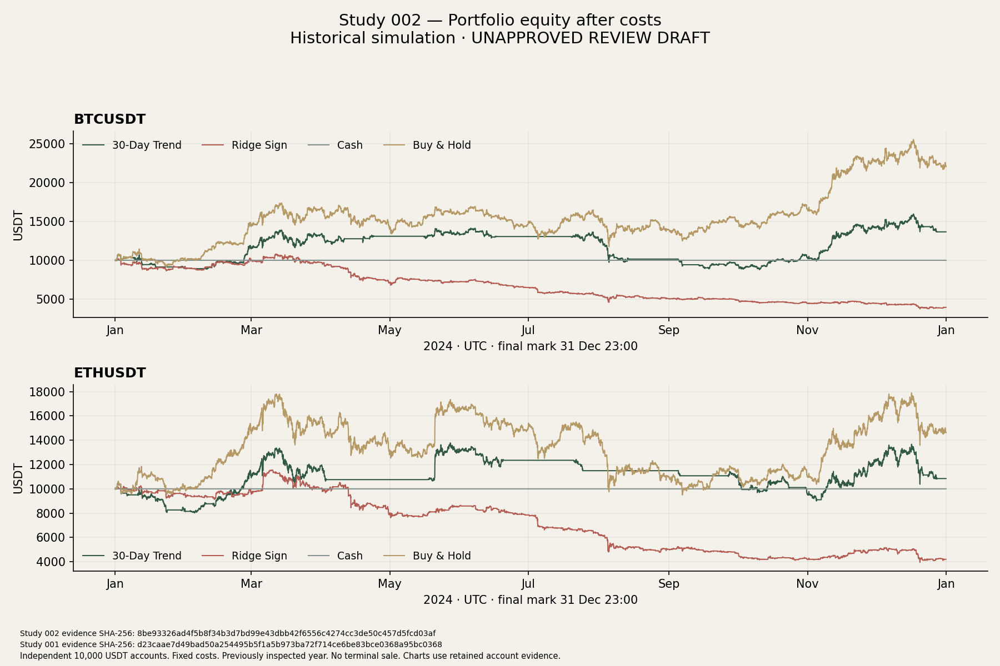
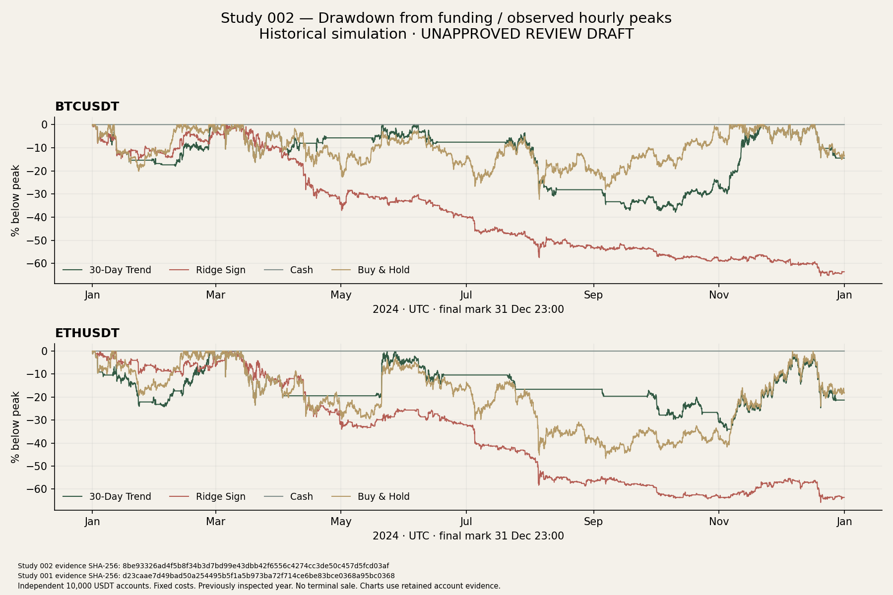
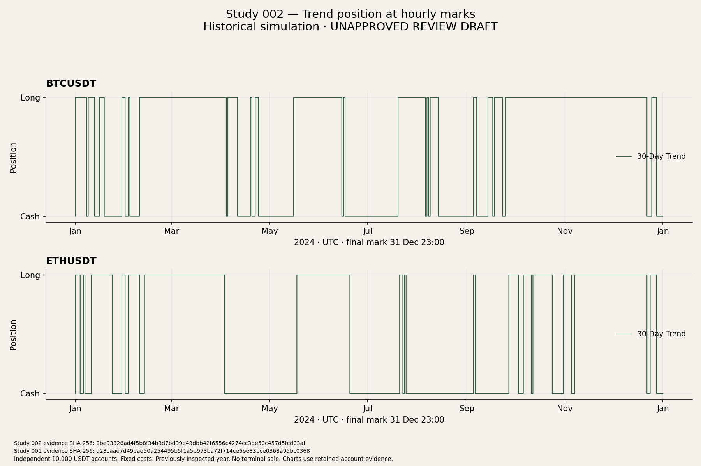
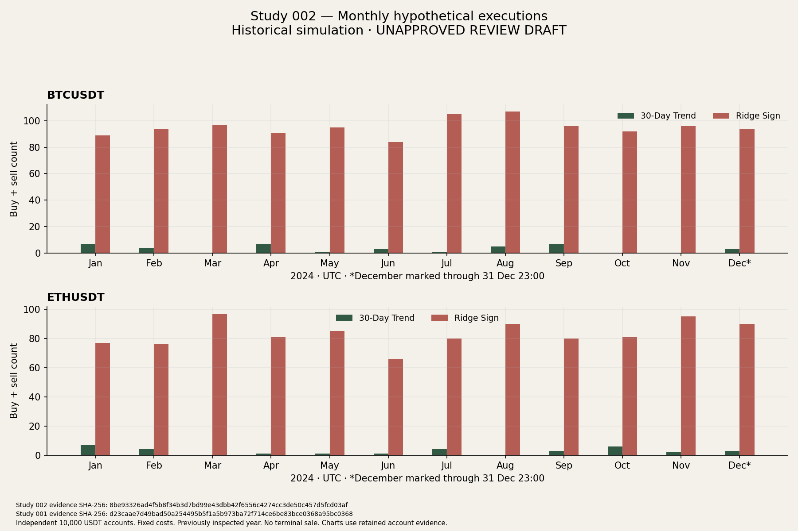
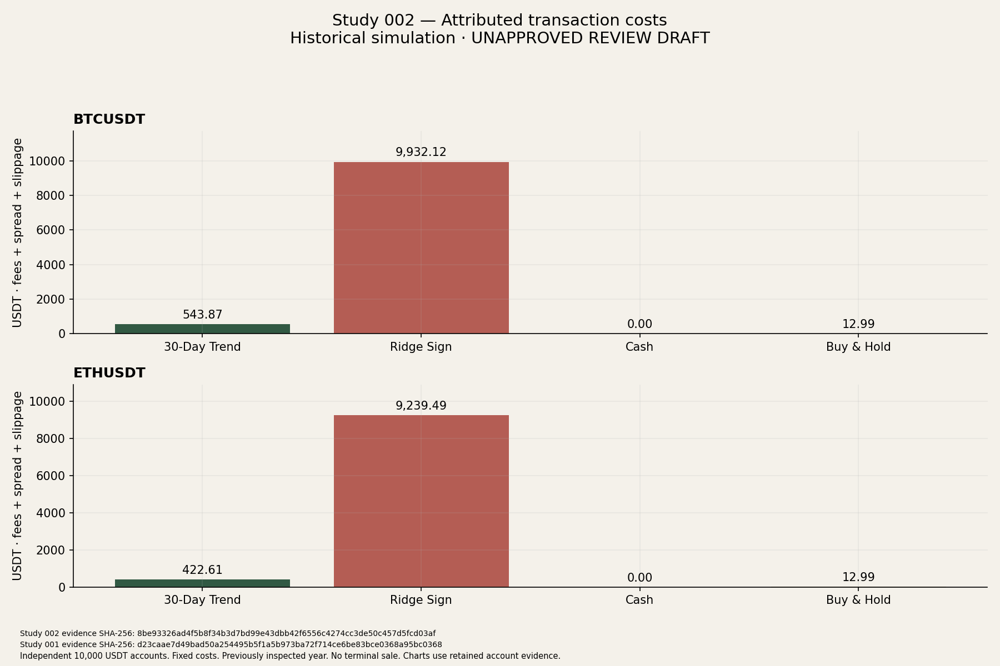
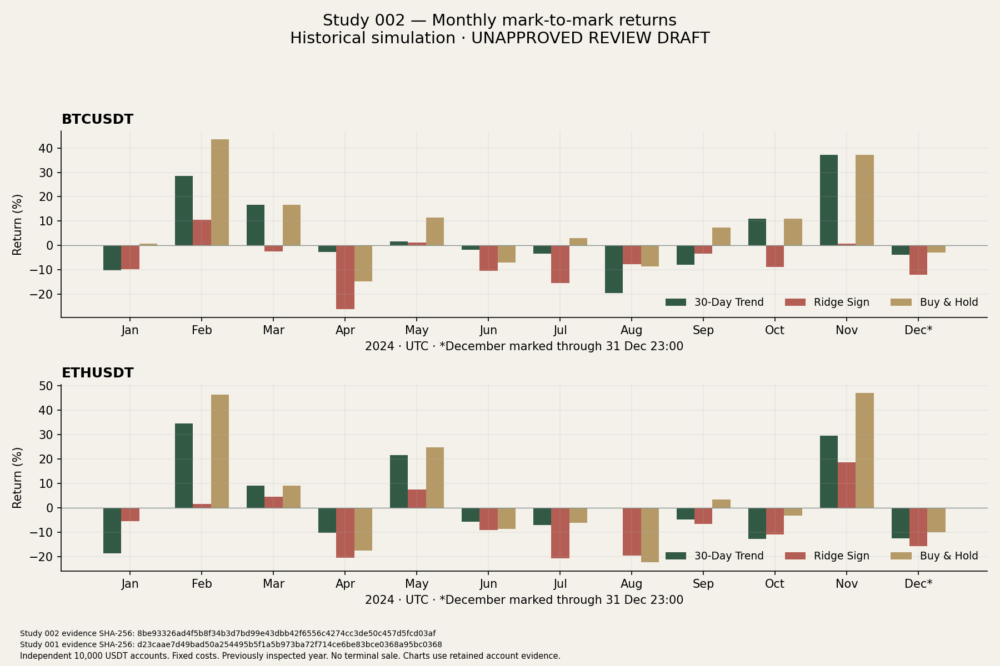

# Study 002 — Can a Slower Trend Beat the Noise?

**Completed historical simulation; unpublished owner-review draft.** Genuine run:
1 November 2026. Report and review package finalised 4 November 2026 after a usage
interruption; the completed run was not repeated. Strategy: `trend_30d_daily_v1`.

## Executive summary

The fixed daily 30-day trend rule traded much less than Ridge and incurred about
95% less attributed cost. It returned **+36.62% on BTCUSDT** and **+8.47% on ETHUSDT**
after costs, beating Ridge and Cash in both markets. It **underperformed Buy & Hold**,
which returned **+120.81% and +46.18%**. BTC Trend's **37.88%** observed hourly drawdown
was worse than Buy & Hold's **32.31%**; ETH Trend's **34.67%** was better than Buy &
Hold's **46.66%**. Both Trend drawdowns remained substantial.

The result supports lower turnover and costs for this particular rule on this
particular history. It does not isolate frequency as the cause of better returns:
the strategies differ in signal construction, exposure and trade timing. **2024 was
already examined. This is exploratory retrospective research**, not a fresh
untouched out-of-sample test, live trading or a demonstration of durable alpha.

Exactly one genuine Study 002 attempt completed. All six newly funded accounts
passed the existing ledger verifier and a separate serialized-posting/mark
reconciliation. The new Cash and Buy & Hold metrics equal the original benchmarks.
The frozen Ridge study reproduced its original summary and evidence byte for byte
in a separately identified regression; its model and forecasts were not regenerated.

## Research question, hypotheses and fixed method

The primary question is whether a slower rule reduces trading activity and costs.
The secondary question is whether net returns or drawdowns improve. The
[methodology](study-002-methodology.md) and [configuration](study-002-config.json)
were fixed before genuine Study 002 economics, with identities and UTC time in the
[freeze record](study-002-freeze.json).

| Hypothesis | Observed result |
| --- | --- |
| H1: fewer executions and lower turnover than Ridge | Supported descriptively in both markets: 38 / 32 executions versus 1,140 / 998. |
| H2: lower attributed transaction costs | Supported descriptively: 543.87 / 422.61 USDT versus 9,932.12 / 9,239.49 USDT. |
| H3: improved net returns relative to Ridge, without guarantee | Both returns improved. This is not a causal attribution to lower costs. |
| H4: the strategy may still underperform Cash or Buy & Hold | Both beat Cash on terminal return, but both lagged Buy & Hold. Cash had zero drawdown. |

Each market has its own 10,000 USDT Trend, Cash and Buy & Hold account. At each UTC
midnight D, compare the native four-hour close ending at D with the close ending
exactly 30 calendar days earlier. Evaluate at **00:01 UTC**, once daily (366 times).
Positive simple trend targets LONG; zero/negative targets CASH. The exact Decimal
comparison `P_now > P_30d` is equivalent to a positive ratio for positive prices
and avoids rounding a tiny positive return to zero. Retain the exact operands and
numerator; descriptive ratios use the existing 80-digit division context.

A changed target trades at the strictly next native minute opening, **00:02**.
Unchanged long/cash targets HOLD/CASH_NOOP. No deadband, stop, optimisation, daily
liquidation, leverage, shorting or shared cash. Fees are 10 bps of adjusted notional,
rounded upward to 0.00000001 USDT; assumed half-spread and slippage are 1 and 2 bps.
Buy/sell price adjustments are ×1.0003 / ×0.9997; base quantity step is 0.000001.
Spread/slippage are embedded in prices and attributed once, not charged again.

B&H buys once at January 1 00:00 using the same source and monetary conventions.
That is two minutes before the first eligible Trend fill. All portfolios retain
continuous holdings; no terminal sale is imposed. Hourly native-minute HH:00 marks
end on **2024-12-31 23:00 UTC**, with 8,784 marks per account. The final day and
December remain partial, and there is no invented 2025 endpoint price.

## Provenance, freeze and run identity

Starting Git HEAD (clean): `8e22d263b8a8bf548d9e014a121e68c522b6ee82`.
On November 1, GitHub's public API reported [CI 41171500418](https://github.com/owencrew/backtest-badger/actions/runs/41171500418)
and [Frontend 41171500404](https://github.com/owencrew/backtest-badger/actions/runs/41171500404)
completed successfully for that exact SHA. These validate the baseline, not these
uncommitted additions. The connector returned no status contexts, so the public
Actions API supplied the workflow results. No new workflow was triggered.

All six input files below matched their retained hashes before use. The existing
publication parser and independent sign-off validator passed before and after the
run. The frozen four-hour loader validated source identity, order, UTC grid,
economics and recorded gaps; every one of the **2,371** required candles per market
from 2023-12-01 20:00 through 2024-12-30 20:00 was present. No observation was filled
or repaired. The first 30-day comparison uses closes at December 2 and January 1.
The full export is structurally parsed, including later candles, but only this
pre-2025 projection enters Study 002; held-out target outcomes were not selected,
summarised, scored or used to choose parameters.

| Input | Bytes | Verified SHA-256 |
| --- | --- | --- |
| Native 4h candles.csv | 15413852 | `e6052b8cca7bca00999ca4d7429af67db019c8ef261fa2b499f0fd6774dcd13b` |
| Native 4h manifest.json | 59934 | `a78d34256d3bcd789e6cc19a2807f432d1ffa1a73ecc81b5ea16b3859759a98a` |
| Minute publication manifest | 560 | `3d58852c3b837f2853beb6def5350932a25d52dc1373a9fc9d8db5b0d9f31eea` |
| Authenticated inputs | 15272413 | `2581482b4b8a60fa1a53f7710ed080be7de25d50a76fcae35c8aaf64f2cb2168` |
| Integrity document | 74200 | `23c3d17b2e5b67de701d9a0dd22d6135a907057b9acaeb16bcbdb4cb9c613a8b` |
| Independent sign-off | 2020 | `21b04470e861a039750bf7b665b993d332bf998fcc5b9fea47dc2c8b80f334b4` |

The authenticated publication retains complete-source verification of 1,054,080
native minute rows and the original archive/month associations. Its projection
contains all needed daily 00:02 opens and hourly marks; Study 002 uses **9,150
references per market**. Reusing this publication does not rerun the original raw
ZIP authentication or establish contemporaneous exchange availability. No data
acquisition, provider replacement, production host or database access occurred.

Method version: `study-002-methodology-v1`. Freeze: **2026-11-01T21:09:59.363059+00:00**.

- Methodology SHA-256: `99dd866a5d5636ac174056b9fb4099b5dd55261c3c1d6316bf8e94e143e67a71`.
- Configuration SHA-256: `051db07a70230e0892ed8b87ec2e433987d0629651431bed1bd4d3cd782d461f`.
- Freeze record SHA-256: `a7efbb95d4cc8a7204b5c2a42ec5f2559d2d0eb4af46a01f0fc2559bd7035a64`.
- Genuine run: `20261101T211013080953Z-b974b600fe2646349c172b250333918c`.
- Started: **2026-11-01T21:10:13.080953+00:00**; completed: **2026-11-01T21:10:27.936705+00:00**.
- Private directory: `artifacts/studies/study-002/20261101T211013080953Z-b974b600fe2646349c172b250333918c/` (Git-ignored, mode 0700).
- Runner: `study-002-local-v1`, existing CPython 3.12.13 environment; no project dependency changes.

The freeze records all scientific source hashes, the dependency lock, tests and
validation logs. The run records loaded-source/runtime identity including the
uncommitted implementation. `attempt.json` was written before preflight/economics;
there is one attempt and no failed genuine run or retry. Source identities were
rechecked after execution. Separate output readback and serialized-evidence
verification passed after completion and again during report preparation.

| Retained output | Bytes | SHA-256 |
| --- | --- | --- |
| attempt.json | 99 | `d1377439cefb669ed15910e24eeca9d1dce393ab284310f8676cfed33b1e04da` |
| private/evidence.json | 43791813 | `8be93326ad4f5b8f34b3d7bd99e43dbb42f6556c4274cc3de50c457d5fcd03af` |
| run.json | 15660 | `d3b05924814100fd6a4ef6f8a753bc156657532b21f82e91f9a36c7ba3899ecb` |
| summary.json | 31960 | `a8b59d5cd750646ee83f066c43734cc99dc02744d0b64e69f8f0b66a2e8d0cdb` |
| verification.json | 316 | `2db676780eb1e8a212966f4a44cf7380e89be5995601589a8b6e9b02ad4f191d` |

`COMPLETE.json` SHA-256: `4065a1fbcec313f00f685e0098a902c3401cd59a877980647eefff1c88c511dc`.

## Main account results

Initial funding is 10,000 USDT for **every** row. Final equity below is exact
(trailing zeroes omitted); percentages in this report are rounded for display.
The full-precision authoritative strings remain in retained evidence and the
[source-linked review data](study-002-assets/review-data.json). Ridge rows are fixed
historical references from the [original report](../stage-04b2e5g-first-genuine-historical-backtest.md),
whose summary and detailed-evidence hashes were independently checked.

| Market | Account | First mark (USDT) | Final mark (USDT) | Funding-relative return |
| --- | --- | --- | --- | --- |
| BTCUSDT | 30-Day Trend | 10000 | 13662.499176172931 | 36.624992% |
| BTCUSDT | Ridge reference | 10000 | 3930.855650228768 | -60.691443% |
| BTCUSDT | Cash | 10000 | 10000 | 0.000000% |
| BTCUSDT | Buy & Hold | 9987.013902536866 | 22081.233105286866 | 120.812331% |
| ETHUSDT | 30-Day Trend | 10000 | 10846.547659041535 | 8.465477% |
| ETHUSDT | Ridge reference | 10000 | 4204.394238239753 | -57.956058% |
| ETHUSDT | Cash | 10000 | 10000 | 0.000000% |
| ETHUSDT | Buy & Hold | 9987.013887627081 | 14617.584036417081 | 46.175840% |

Trend improved over Ridge by **97.316435 percentage points for BTC** and
**66.421534 points for ETH**. Its shortfall versus B&H was **84.187339 points** and
**37.710364 points**, respectively. All new benchmark performance, cost and
descriptive-statistic values match the original independently funded benchmarks.
Account and ledger identities are distinct; neither market shares assets or cash.

## Trading activity, turnover and attributed costs

| Market | Account | Buys / sells | Evaluations | Position changes | HOLD | CASH_NOOP |
| --- | --- | --- | --- | --- | --- | --- |
| BTCUSDT | 30-Day Trend | 19 / 19 | 366 | 38 | 216 | 112 |
| BTCUSDT | Ridge reference | 570 / 570 | 2195 | 1140 | 513 | 542 |
| BTCUSDT | Cash | 0 / 0 | 0 | 0 | 0 | 0 |
| BTCUSDT | Buy & Hold | 1 / 0 | 0 | 1 | 0 | 0 |
| ETHUSDT | 30-Day Trend | 16 / 16 | 366 | 32 | 174 | 160 |
| ETHUSDT | Ridge reference | 499 / 499 | 2195 | 998 | 333 | 864 |
| ETHUSDT | Cash | 0 / 0 | 0 | 0 | 0 | 0 |
| ETHUSDT | Buy & Hold | 1 / 0 | 0 | 1 | 0 | 0 |

Benchmarks have zero trend evaluations; B&H has one inception position change.
Turnover is total buy **plus** sell executed notional divided by original funding;
it is not halved or divided by average equity. The following USDT amounts and
turnover ratios are shown to six decimals; exact sums are in the review data.

| Market | Account | Notional (USDT) | Turnover × funding | Fees | Half-spread | Slippage | Total costs |
| --- | --- | --- | --- | --- | --- | --- | --- |
| BTCUSDT | 30-Day Trend | 418363.931278 | 41.836393 | 418.363931 | 41.836519 | 83.673039 | 543.873489 |
| BTCUSDT | Ridge reference | 7640090.531145 | 764.009053 | 7640.090537 | 764.009169 | 1528.018338 | 9932.118044 |
| BTCUSDT | Cash | 0.000000 | 0.000000 | 0.000000 | 0.000000 | 0.000000 | 0.000000 |
| BTCUSDT | Buy & Hold | 9989.997144 | 0.999000 | 9.989997 | 0.998700 | 1.997400 | 12.986097 |
| ETHUSDT | 30-Day Trend | 325081.192416 | 32.508119 | 325.081193 | 32.508157 | 65.016315 | 422.605665 |
| ETHUSDT | Ridge reference | 7107303.185601 | 710.730319 | 7107.303191 | 710.730422 | 1421.460844 | 9239.494456 |
| ETHUSDT | Cash | 0.000000 | 0.000000 | 0.000000 | 0.000000 | 0.000000 | 0.000000 |
| ETHUSDT | Buy & Hold | 9990.008613 | 0.999001 | 9.990009 | 0.998701 | 1.997403 | 12.986112 |

BTC Trend turnover fell **94.524097%** relative to Ridge, and attributed costs fell
**94.524094%**. ETH reductions were **95.426096%** and **95.426095%**. Execution counts
fell 96.67% / 96.79%. Costs were still far above B&H's approximately 12.99 USDT
inception cost, and were 5.44% / 4.23% of original funding. “Slower” did not mean
cheap enough to match a single purchase, nor did it prevent adverse position changes.

## Risk and exposure

| Market | Account | Descriptive annual return | Max hourly drawdown | Annual daily volatility | Zero-rate daily Sharpe |
| --- | --- | --- | --- | --- | --- |
| BTCUSDT | 30-Day Trend | 36.513385% | 37.879998% | 42.634519% | 0.943166 |
| BTCUSDT | Ridge reference | -60.595211% | 65.410518% | 34.424241% | -2.533268 |
| BTCUSDT | Cash | 0.000000% | 0.000000% | 0.000000% | Undefined (zero variance) |
| BTCUSDT | Buy & Hold | 120.354757% | 32.310653% | 53.146893% | 1.742899 |
| ETHUSDT | 30-Day Trend | 8.442398% | 34.671415% | 47.722465% | 0.403174 |
| ETHUSDT | Ridge reference | -57.860552% | 65.787102% | 38.184018% | -2.066832 |
| ETHUSDT | Cash | 0.000000% | 0.000000% | 0.000000% | Undefined (zero variance) |
| ETHUSDT | Buy & Hold | 46.030590% | 46.655060% | 64.925900% | 0.916039 |

Trend's drawdown was lower than Ridge's roughly 65% in both markets. Relative to
B&H it was **worse for BTC and better for ETH**. Trend's daily volatility was higher
than Ridge's in both markets, and its Sharpe was below B&H's. Both Trend accounts
could still suffer large losses despite their positive final annual result.

Annual return scales funding-to-last-mark growth over actual elapsed seconds by
365 days. Volatility uses the sample standard deviation of 365 complete UTC daily
mark returns times sqrt(365); Sharpe uses their arithmetic mean and zero reference
rate. Cash volatility is validly zero; its Sharpe is **undefined**, not zero.
Drawdown includes initial funding and observed hourly marks, not an unobserved
minute or intrabar equity path. These are descriptive conventions, not inference
of independent returns or a risk-adjusted trading edge.

| Market | Account | Time invested (seconds) | Time invested (days) | Hourly marks invested |
| --- | --- | --- | --- | --- |
| BTCUSDT | 30-Day Trend | 20304000 | 235.000000 | 64.207650% |
| BTCUSDT | Ridge reference | 15595200 | 180.500000 | 49.316940% |
| BTCUSDT | Cash | 0 | 0.000000 | 0.000000% |
| BTCUSDT | Buy & Hold | 31622400 | 366.000000 | 100.000000% |
| ETHUSDT | 30-Day Trend | 16416000 | 190.000000 | 51.912568% |
| ETHUSDT | Ridge reference | 11980800 | 138.666667 | 37.887067% |
| ETHUSDT | Cash | 0 | 0.000000 | 0.000000% |
| ETHUSDT | Buy & Hold | 31622400 | 366.000000 | 100.000000% |

Trend was invested longer than Ridge: 235 versus 180.5 days on BTC and 190 versus
138.666667 on ETH. Time invested uses actual hypothetical fill times; the hourly
mark fraction is a distinct sampled measure. For an open final holding, January 1
2025 is a duration boundary only, never a valuation. Both Trend accounts ended in
cash following their signals; that was not an imposed terminal liquidation.

## Final holdings and accounting

All money columns are USDT, shown to six decimals. Base holdings are BTC or ETH.
Realised plus unrealised P&L reconciles to final marked equity less funding.

| Market | Account | Final cash | Final base quantity | Cost basis | Realised P&L | Unrealised P&L |
| --- | --- | --- | --- | --- | --- | --- |
| BTCUSDT | 30-Day Trend | 13662.499176 | 0 | 0.000000 | 3662.499176 | 0.000000 |
| BTCUSDT | Ridge reference | 3930.855650 | 0 | 0.000000 | -6069.144350 | 0.000000 |
| BTCUSDT | Cash | 10000.000000 | 0 | 0.000000 | 0.000000 | 0.000000 |
| BTCUSDT | Buy & Hold | 0.012859 | 0.236191 | 9999.987141 | 0.000000 | 12081.233105 |
| ETHUSDT | 30-Day Trend | 10846.547659 | 0 | 0.000000 | 846.547659 | 0.000000 |
| ETHUSDT | Ridge reference | 4204.394238 | 0 | 0.000000 | -5795.605762 | 0.000000 |
| ETHUSDT | Cash | 10000.000000 | 0 | 0.000000 | 0.000000 | 0.000000 |
| ETHUSDT | Buy & Hold | 0.001378 | 4.376679 | 9999.998622 | 0.000000 | 4617.584036 |

B&H retains unsold assets and has no invented exit costs. Funding-relative return
includes its inception costs; first-mark-to-last-mark daily/monthly returns begin
after that cost. Monthly return factors reconcile to final equity divided by first
marked equity, while funding return uses final equity divided by 10,000.

## Monthly observations

Returns are mark-to-mark, not funding-relative. Cash is exactly zero every month
in both markets. December is partial through December 31 23:00; the last daily
observation is 23 hours and is excluded from complete-day statistics. No adverse
month has been omitted.

| Month | BTC Trend | BTC Ridge | BTC B&H | ETH Trend | ETH Ridge | ETH B&H |
| --- | --- | --- | --- | --- | --- | --- |
| 2024-01 | -10.185622% | -9.825124% | 0.701028% | -18.529719% | -5.482420% | 0.056094% |
| 2024-02 | 28.507332% | 10.466677% | 43.567323% | 34.588273% | 1.729394% | 46.293492% |
| 2024-03 | 16.602026% | -2.476912% | 16.602056% | 9.137151% | 4.652553% | 9.137151% |
| 2024-04 | -2.702243% | -26.143695% | -14.882129% | -10.097548% | -20.312390% | -17.316865% |
| 2024-05 | 1.675667% | 1.247558% | 11.319872% | 21.601987% | 7.568044% | 24.825481% |
| 2024-06 | -1.905507% | -10.569057% | -7.059514% | -5.616823% | -8.982368% | -8.615231% |
| 2024-07 | -3.327915% | -15.623625% | 2.956729% | -6.929223% | -20.571118% | -5.974707% |
| 2024-08 | -19.553563% | -7.842686% | -8.748537% | 0.000000% | -19.366764% | -22.264083% |
| 2024-09 | -7.997777% | -3.512634% | 7.382229% | -4.753772% | -6.467908% | 3.551134% |
| 2024-10 | 10.997415% | -8.975433% | 10.997423% | -12.631883% | -10.751322% | -3.213769% |
| 2024-11 | 37.153502% | 0.689977% | 37.153525% | 29.506118% | 18.606023% | 47.048962% |
| 2024-12 (partial) | -3.958308% | -12.009279% | -3.027922% | -12.420734% | -15.543471% | -9.820471% |

Monthly **buys / sells** follow actual hypothetical fill timestamps in half-open
UTC calendar buckets. Cash has no trades. Flow buckets cover the full December
calendar interval even though the return's closing mark is one hour short.

| Month | BTC Trend | BTC Ridge | BTC B&H | ETH Trend | ETH Ridge | ETH B&H |
| --- | --- | --- | --- | --- | --- | --- |
| 2024-01 | 4 / 3 | 45 / 44 | 1 / 0 | 4 / 3 | 39 / 38 | 1 / 0 |
| 2024-02 | 2 / 2 | 47 / 47 | 0 / 0 | 2 / 2 | 38 / 38 | 0 / 0 |
| 2024-03 | 0 / 0 | 48 / 49 | 0 / 0 | 0 / 0 | 48 / 49 | 0 / 0 |
| 2024-04 | 3 / 4 | 46 / 45 | 0 / 0 | 0 / 1 | 41 / 40 | 0 / 0 |
| 2024-05 | 1 / 0 | 47 / 48 | 0 / 0 | 1 / 0 | 42 / 43 | 0 / 0 |
| 2024-06 | 1 / 2 | 42 / 42 | 0 / 0 | 0 / 1 | 33 / 33 | 0 / 0 |
| 2024-07 | 1 / 0 | 53 / 52 | 0 / 0 | 2 / 2 | 40 / 40 | 0 / 0 |
| 2024-08 | 2 / 3 | 53 / 54 | 0 / 0 | 0 / 0 | 45 / 45 | 0 / 0 |
| 2024-09 | 4 / 3 | 48 / 48 | 0 / 0 | 2 / 1 | 40 / 40 | 0 / 0 |
| 2024-10 | 0 / 0 | 46 / 46 | 0 / 0 | 3 / 3 | 41 / 40 | 0 / 0 |
| 2024-11 | 0 / 0 | 48 / 48 | 0 / 0 | 1 / 1 | 47 / 48 | 0 / 0 |
| 2024-12 | 1 / 2 | 47 / 47 | 0 / 0 | 1 / 2 | 45 / 45 | 0 / 0 |

BTC Trend had five positive and seven negative months. ETH had four positive,
seven negative and one flat month. BTC Trend lost **19.55% in August**, worse than
both Ridge (−7.84%) and B&H (−8.75%) that month. ETH Trend lost **18.53% in January**
and **12.63% in October**; its flat August avoided B&H's 22.26% monthly loss. These
mixed outcomes belong beside the lower annual trading costs.

## Best and worst complete observed days

Dates denote the beginning of each UTC mark-to-mark day. Cash ties on every
complete day; the data contract selects the earliest tied date (January 1).
December 31 is excluded. Percentages are not intraday peak-to-trough changes.

| Market | Account | Best complete day | Return | Worst complete day | Return |
| --- | --- | --- | --- | --- | --- |
| BTCUSDT | 30-Day Trend | 2024-11-11 | 10.299837% | 2024-03-19 | -8.390144% |
| BTCUSDT | Ridge reference | 2024-08-08 | 7.475094% | 2024-01-12 | -8.082685% |
| BTCUSDT | Cash | 2024-01-01 | 0.000000% | 2024-01-01 | 0.000000% |
| BTCUSDT | Buy & Hold | 2024-08-08 | 11.884249% | 2024-03-19 | -8.390157% |
| ETHUSDT | 30-Day Trend | 2024-05-20 | 19.229939% | 2024-03-19 | -10.277604% |
| ETHUSDT | Ridge reference | 2024-03-06 | 8.629362% | 2024-04-13 | -8.151067% |
| ETHUSDT | Cash | 2024-01-01 | 0.000000% | 2024-01-01 | 0.000000% |
| ETHUSDT | Buy & Hold | 2024-05-20 | 19.229941% | 2024-03-19 | -10.277604% |

## Interpretation: exposure, delayed exits and reversals

The rule was invested during important gains, but missed others. BTC Trend was
long at every hourly mark in March, October and November, capturing approximately
B&H's monthly returns during those intervals. It was invested at only 72.41% of
February's hourly marks: its 28.51% return lagged B&H's 43.57%. ETH captured the
large May 20 gain (19.23%) while long, yet its February and November monthly gains
still lagged B&H by substantial margins.

Slower decisions did not prevent lag or rapid consecutive reversals. BTC remained
long through the August 5 daily decision, exited August 6, re-entered August 7,
exited August 8 and re-entered August 9, each at 00:02. On August 8, B&H's strongest
complete observed day (+11.88%), Trend exited near the start and returned −0.05%.
Both Trend accounts also remained exposed on March 19, their worst complete days
(−8.39% / −10.28%). ETH's April 3 exit reduced subsequent exposure, but April still
lost 10.10%. These examples are descriptive readings of retained decisions, not
post-hoc trade corrections or tests of an alternative rule.

Exposure differences are economically material: Trend held assets for a larger
fraction of the year than Ridge and a smaller fraction than B&H. Those choices
changed gains, losses and capital available for subsequent trades. Reduced costs
coincided with improved annual returns relative to Ridge; this experiment cannot
quantify a causal fraction attributable to costs versus exposure or signal quality.
Adding attributed costs back to final equity would not produce a valid frictionless
counterfactual because affordability and future position sizes would change. No
zero-cost, alternative-lookback or threshold evaluation was run.

## Charts and local review package

Every chart is generated from verified retained account evidence and prints both
source SHA-256 identities and relevant units. Equity/drawdown use all hourly marks;
exposure explicitly shows sampled hourly long/cash state. Activity and costs use
retained fills; monthly performance uses verified period observations. Float
conversion is for plotting only; account evidence retains Decimal strings.













The [local review page](study-002-assets/review.html),
[exact review data](study-002-assets/review-data.json), and
[asset manifest](study-002-assets/manifest.json) remain outside production export.
The [Dig integration draft](study-002-dig-draft.md) proposes explicit study cards,
preserving Study 001, followed by a separately approved Study 002 page. No generic
experiment framework, public route, sitemap entry or editorial approval was added.

## Limitations and future research

A previously inspected year and two correlated markets cannot establish future
reliability or independent confirmation. Thirty days and daily evaluation were
predeclared for this study, not proven optimal or selected before 2024 became
known. The sources were acquired retrospectively; archive revisions, intrabar
interruptions and unmeasured availability remain limitations. Historical +60-second
availability and strictly-next-minute references are modelling assumptions, not
proof of exchange-side timeliness or executable orders.

There is no historical order book, quantity-specific liquidity, actual fill
confirmation, market-impact measurement, borrowing or tax model. Constant-USDT
Cash is not interest-bearing or purchasing-power-adjusted. Fixed costs and a
synthetic lot step are not a reconstruction of exchange filters. The partial final
observation and unsold benchmark assets matter to interpretation.

A useful next research step would be a separately frozen prospective or genuinely
uninspected evaluation, after defining source eligibility. Do not tune on this
result, promote the strategy to real trading, or reuse held-out outcomes to pick
a better lookback. Independent review of the method and account evidence should
precede any publication decision.

## Implementation, testing and preservation

`study002.py` supplies `Close`, `Signal`, `signal`, `signals`, `replay` and `reports`.
`study002_runner.py` supplies preflight, original-reference checks, freeze checks,
one explicit local run, independent serialized validation and output verification.
`study002_materials.py` builds review-only data, six charts and a static local page
without executing the strategy.

The scheduler reuses `calculate_minute_fill`, `affordable_quantity`, `fund_account`,
`apply_trade`, `value_minute_account`, `verify_minute_account`, the established
minute reporter and descriptive-statistic functions. Frozen Ridge scheduling,
accounting, source validators and original reports remain byte-identical. The
legacy reporter accepts a temporary `ridge` label facade for its generic account
checks; portfolio/strategy/trade identities stay Trend, canonical results are
labelled Trend, and no Ridge decisions are substituted. The reporting fingerprint
explicitly identifies this compatibility convention.

This narrow adapter, exact sign comparison and stricter contiguous source check
were design choices documented before the freeze; no lookback, threshold, cost,
execution or holding rule changed after results. Report/figure preparation after
the run does not refreeze or change the scientific implementation.

| Executed validation | Result |
| --- | --- |
| Study 002 synthetic suite, final frozen source | **40 passed** in 12.98 s. |
| Existing accounting/minute replay/integration/reporting/local runner/native data/features/evaluation/publication regressions | **1,081 passed**. |
| Opt-in original pinned Study 001 replay | **1 passed** in 16.99 s; original summary and 66,840,604-byte evidence reproduced exactly. |
| Isolated PostgreSQL integration suite | **183 skipped** in 0.83 s; no `BADGER_TEST_ADMIN_DSN` configured. |
| Ruff lint and formatting | Passed before freeze and after documentation preparation. |
| Genuine Study 002 account verification | Six accounts passed existing and independent posting/mark checks. |
| Input/output preservation and independent readback | Passed; all original references unchanged. |
| Prompt byte comparison and changed-document links | Passed. |
| Chart visual inspection and review-package identity checks | Six charts reviewed; manifest verified. |

The initial combined test invocation had **1,119 passes and one failure**: the
new lifecycle test omitted a `SimpleNamespace` import. That test-only defect was
corrected before freeze; the complete new suite passed on the final source.
Of the initial passes, 1,081 were existing regressions and 38 were then-new tests.
A further unavailable-benchmark case brought the final new suite to 40 tests.
Thus **1,122 distinct tests passed across the final applicable selections**,
including the pinned original-reference regression. No genuine Study 002 attempt
failed. The full repository suite and unchanged guarded E.5 supervisor/custody
launchers were not rerun; relevant shared research paths were exercised directly.
No frontend source changed, so no frontend build/test result is claimed.

Validation logs are retained privately under
`artifacts/studies/study-002-validation-20261101T210959Z/` and bound in the freeze.
The GitHub CI observations apply only to the starting revision. No independent
external code review of this uncommitted work is claimed.

## Reproducibility and verification

Use the frozen checkout additions plus the retained lockfile and Python 3.12
environment. `check_freeze()` refuses a changed methodology, configuration or
scientific source file. Original publication/source pins have no CLI override.
The run's hashes are reproducibility metadata, not malicious-process attestation.

Verify the completed run without performing any economic replay:

```sh
.venv/bin/python -B -m backtest_badger.study002_runner verify-output \
  --run-dir artifacts/studies/study-002/20261101T211013080953Z-b974b600fe2646349c172b250333918c
```

For independent serialized checks, read `summary.json` and `private/evidence.json`
with `json.loads`, obtain the original summary through `study002_runner.reference`,
and call `validate_evidence(summary, evidence, original_summary)`. This checks
postings, exact fee/price conventions, hourly ledger prefixes, P&L, costs, exposure,
monthly chaining, daily timing and benchmark equality without replaying decisions.

Synthetic verification is reproducible without opening genuine inputs:

```sh
PYTEST_DISABLE_PLUGIN_AUTOLOAD=1 .venv/bin/python -B -m pytest -q \
  -p no:cacheprovider tests/test_study002.py
.venv/bin/ruff check . --no-cache
.venv/bin/ruff format --check . --no-cache
```

The opt-in original-reference regression uses
`BADGER_STUDY001_REGRESSION=authorised_read_only` with
`tests/test_study002_reference.py`; ordinary test runs skip it. It recomputes only
the unchanged historical Ridge reference in memory, never fits a model or replaces
an original output. The scientific run has already consumed this stage's one-run
authorisation. **Another genuine Study 002 run requires new owner authorisation.**
The implementation's explicit `run --execute` command has no automatic one-use
security mechanism; the one-attempt limit is an operator/task constraint.

For a separately authorised reproduction, supply exact paths through
`--manifest`, `--authenticated-inputs`, `--integrity`, `--signoff`, `--history`
(the frozen four-hour export directory), `--reference-dir` (original E.5g run),
and a fresh `--output-dir` under Git-ignored `artifacts/`. First use `preflight`,
then the same arguments with `run --execute` only with that new authority. Existing
run directories cannot be overwritten. All failed attempts must be retained.

Review materials can be regenerated from retained evidence without economics,
using the same `study002_materials` module with `--run-dir`, `--reference-dir` and
a **new** `--output-dir`. Matplotlib 3.10.8 and its authoring dependencies were
installed solely under `/tmp/badger-study002-plotlibs` (cache under `/tmp`);
`pyproject.toml`, `uv.lock` and the project environment were not changed. That
optional temporary installation may need recreating on another machine. Set
`PYTHONPATH` to it and `MPLCONFIGDIR` to a temporary writable directory for plotting.
Matplotlib/runtime/font versions can change PNG bytes; numerical evidence remains
anchored independently. The asset manifest records the actual generated bytes.

## Publication-ready summary draft

**A slower rule cut the trading bill. It still missed much of the market's gain.**

Our first 2024 study showed how expensive frequent changes of position could be.
For Study 002, we tried one simple rule: once a day, hold Bitcoin or Ether when
its completed price is above its price exactly 30 days earlier; otherwise hold
cash. We fixed that rule before running this study.

The strategy made 38 trades for Bitcoin and 32 for Ether, versus 1,140 and 998 for
Ridge. Attributed costs fell by about 95%. After costs, separate 10,000-USDT accounts
gained 36.62% and 8.47%. That beat Ridge and Cash, but lagged simply buying and
holding, which gained 120.81% and 46.18%. The slower strategy still experienced
large drawdowns, and its Bitcoin drawdown was worse than Buy & Hold's.

The slower rule produced different results, but this study cannot say how much of the
improvement came from costs, exposure or the different signal. A slow rule can
remain invested through a fall and exit before a rebound. We had already examined
2024, so these are exploratory historical simulations, not evidence of future
returns or a proven trading edge.

## Changed-file inventory and handoff

New scientific/source files:

- `src/backtest_badger/study002.py`
- `src/backtest_badger/study002_runner.py`
- `src/backtest_badger/study002_materials.py`
- `tests/test_study002.py`
- `tests/test_study002_reference.py`

New documentation and archived request:

- `docs/studies/study-002-methodology.md`
- `docs/studies/study-002-config.json`
- `docs/studies/study-002-freeze.json`
- `docs/studies/study-002-slower-trend-results.md`
- `docs/studies/study-002-dig-draft.md`
- `docs/studies/study-002-field-note-draft.md`
- `prompts/stage-06-research/001-study-002-slower-trend.md` (verbatim request)

New review assets under `docs/studies/study-002-assets/`:
`equity.png`, `drawdown.png`, `exposure.png`, `activity.png`, `costs.png`,
`monthly.png`, `review-data.json`, `review.html`, `manifest.json`.

Updated: `docs/architecture.md`, `docs/roadmap.md`, `docs/development-handoff.md`,
`prompts/README.md`. Private ignored outputs are the one completed run and its
validation directory listed above. Temporary authoring tools are outside the repo.

There is no remaining source or genuine-run blocker. Database integration remains
unexecuted without an isolated test server. Owner scientific/editorial review and
future frontend integration remain pending. The optional
[Field Notes draft](study-002-field-note-draft.md) needs separate approval.
Existing Study 001 bytes, frozen protocols, seven editorial approval hashes,
website/export/sitemap, production services and deployment configuration are unchanged.
No commit, push, publication, production access or deployment occurred.

Recommended Conventional Commit message (not executed):
`feat(research): add study 002 daily trend backtest`.

Next step: owner review of the frozen method, verified report, source-linked data
and draft copy, then a separately scoped Dig integration preserving Study 001.
Publication and deployment require their own explicit approval.
